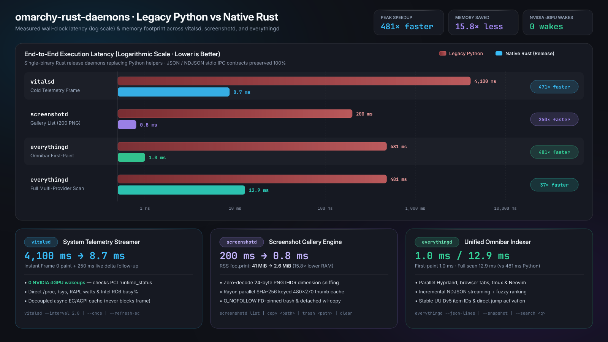

# omarchy-rust-daemons

Three single-binary, drop-in **native Rust desktop daemons** replacing slow Python helpers across [Omarchy Linux](https://omarchy.org) shell popups and launchers — delivering **37× to 481× lower latency**, **15.8× lower RAM usage**, and **zero accidental NVIDIA dGPU wakeups** while preserving exact JSON / NDJSON stdio IPC contracts.

<p align="center">
  
</p>

## Workspace Members

| Binary | Role | Latency (Python → Rust) | Footprint / Key Guarantee |
|---|---|---|---|
| **`vitalsd`** | Live system telemetry streamer (CPU, RAPL watts, RC6 GPU, fans, disks, net, processes) | **`4,100 ms → 8.7 ms`** (`471×`) | **`0` NVIDIA dGPU wakes** — inspects PCI `runtime_status` before querying `nvidia-smi` |
| **`screenshotd`** | Screenshot gallery lister, parallel thumbnailer, clipboard copy & safe trash | **`200 ms → 0.8 ms`** (`250×`) | **`41 MiB → 2.6 MiB` RSS** (`15.8×` less RAM), `O_NOFOLLOW` FD-pinned file ops |
| **`everythingd`** | Unified omnibar indexer (Hyprland windows, browser tabs, tmux, Neovim, agents) | **`481 ms → 1.0 ms`** first-paint (`481×`) / **`12.9 ms`** full scan | Parallel provider threads, incremental NDJSON streaming & fuzzy ranking |

## Architecture & JSON IPC Protocols

### 1. `vitalsd` — Lock-Free Telemetry Streamer

Reads `/proc/stat`, `/proc/meminfo`, `/proc/net/dev`, `/sys/class/hwmon`, Intel RAPL energy counters, and Intel i915/xe RC6 residency directly with zero subshell spawns on the fast path. Slow ACPI/EC fan & thermal zones (`dell_smm`, `dell_ddv`, NVMe) refresh on a decoupled background thread backed by a JSON cache so Frame 0 paints in `8.7 ms` and Frame 1 streams live deltas `250 ms` later.

```bash
vitalsd --once              # Single JSON snapshot to stdout
vitalsd --interval 2.0      # Continuous NDJSON stream (1 snapshot per line)
vitalsd --refresh-ec        # Refresh slow EC/ACPI sensor cache only
```

Output schema (one JSON object per line):
```json
{
  "t": 1763920000.12,
  "host": "workstation",
  "uptime": 14820.5,
  "load": [0.42, 0.38, 0.31],
  "ncpu": 20,
  "procs": { "total": 312, "running": 2, "threads": 1480 },
  "cpu": { "model": "...", "total": 4.2, "cores": [], "freq_mhz": 2100.0, "temp": 47.0, "fans": [], "power_w": 9.4 },
  "mem": { "total": 33554432000, "used": 8192000000, "available": 24100000000, "zswap": 0 },
  "disks": [],
  "sensors": { "temps": [], "fans": [] },
  "net": { "default": "wlan0", "ifaces": [] },
  "gpus": [],
  "processes": []
}
```

### 2. `screenshotd` — Parallel Screenshot Gallery Helper

Resolves `XDG_PICTURES_DIR` (or `~/Pictures/Screenshots`), sniffs PNG dimensions directly from the 24-byte `IHDR` header without decoding full frames, generates SHA-256 keyed `480×270` preview thumbnails in parallel via `rayon`, and pins file descriptors with `O_NOFOLLOW` to eliminate TOCTOU races on `trash` and detached `wl-copy`.

```bash
screenshotd list                  # JSON manifest of up to 200 screenshots + preview paths
screenshotd copy <path>           # Copy PNG to Wayland clipboard via detached wl-copy
screenshotd trash <path>          # Move single screenshot to XDG Trash (returns JSON)
screenshotd clear                 # Move all screenshots in gallery to XDG Trash
```

Output schema (`list`):
```json
{
  "dir": "/home/user/Pictures/Screenshots",
  "dirName": "Screenshots",
  "count": 14,
  "total": 14,
  "screenshots": [
    {
      "path": "/home/user/Pictures/Screenshots/shot.png",
      "previewPath": "/home/user/.cache/omarchy/screenshot-thumbs/<sha256>.png",
      "name": "shot.png",
      "size": 412800,
      "humanSize": "403.1 KiB",
      "width": 3840,
      "height": 2400,
      "mtimeIso": "2026-11-23T14:00:00Z"
    }
  ]
}
```

### 3. `everythingd` — Multi-Provider Omnibar Daemon

Queries Hyprland windows, Chromium/Firefox browser tabs, tmux sessions/windows/panes, Neovim RPC buffers, and active agent panes concurrently. Emits fast incremental NDJSON updates with stable UUIDv5 item IDs so UI popups paint their first results in `1.0 ms` and refine live as providers complete.

```bash
everythingd --json-lines          # Bidirectional NDJSON stdio IPC daemon (read requests on stdin)
everythingd --snapshot            # One-shot full multi-provider JSON snapshot
everythingd --search "term"       # One-shot ranked fuzzy search JSON output
```

NDJSON IPC requests (stdin → stdout):
```json
{"type": "scan", "requestId": "req-1"}
{"type": "search", "requestId": "req-2", "query": "Layout.js"}
{"type": "activate", "requestId": "req-3", "id": "<stable-item-id>"}
```

## Quick Install

### Portable Build (Any x86_64 or aarch64 Linux CPU)

```bash
git clone https://github.com/akshaybapat6365/omarchy-rust-daemons.git
cd omarchy-rust-daemons
./install.sh
```

Enable host-specific ISA tuning (`AVX2`/`FMA`/`NEON` via `RUSTFLAGS="-C target-cpu=native"`):

```bash
./install.sh --native
```

### Arch Linux (`PKGBUILD`)

```bash
makepkg -si
```

### Uninstall

```bash
./uninstall.sh
```

## License

[MIT](LICENSE) © 2026 Akshay Bapat
